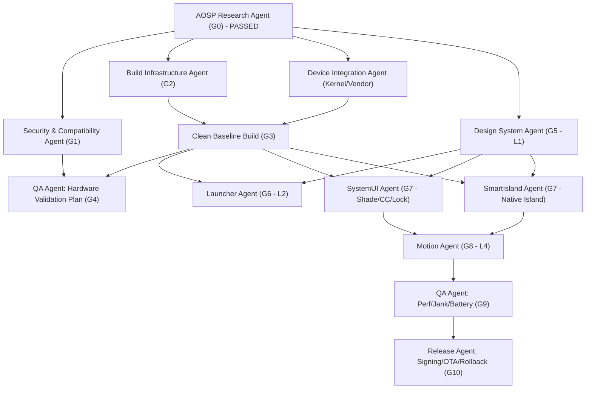

# OriginPixel OS 17 — Multiagent Task Graph

## Agent Roles & Dependencies

## Active & Next Assignments

| Task ID | Owner Role | Description | Status | Gate |
| :--- | :--- | :--- | :--- | :--- |
| `T0-01` | Orchestrator | VPS environment audit & machine-readable JSON | **DONE** | Phase 0 |
| `T0-02` | AOSP Research Agent | Verify Pixel 10 Pro XL (`mustang`) & LineageOS 24.0 repos | **DONE** | G0 |
| `T0-03` | Build Infrastructure Agent | Create local manifest & build-host bootstrap script | **DONE** | G2 |
| `T1-01` | Security & Compatibility Agent | Independent restore verification of `legacy-pixel-projects-2026-11-22.tar.gz` into `/tmp` & Play Integrity risk matrix | **DONE (LOCAL RESTORE; OFF-SITE DR PENDING)** | G1 |
| `T2-01` | Build Infrastructure Agent | Provision dedicated 32–64 GiB RAM / 500+ GB NVMe build host | **WAITING (User/Infra)** | G2 |
| `T3-01` | Build Infrastructure Agent | Sync pinned LineageOS tree, compile clean mustang baseline and verify integration signatures | **BLOCKED ON T2-01** | G3 |
| `T4-01` | QA Agent | Validate on authorized physical mustang device after clean build and rollback readiness | **GATED (EXPLICIT USER AUTH)** | G4 |
| `T5-01` | Design System Agent | Author original L1 design tokens (color, blur, typography, spacing, RRO map) | **DONE (RRO TARGETS UNVERIFIED)** | G5 |
| `T6-01` | Launcher Agent | Define testable home, dock, folder, and interaction state contract | **DONE (FRAMEWORK-NEUTRAL; ANDROID INTEGRATION BLOCKED)** | G6 |
| `T7-01` | SmartIsland Agent | Define native SystemUI shade, Control Center, lock-screen and SmartIsland integration contracts | **DONE (UPSTREAM WIRING BLOCKED ON G3 SOURCE)** | G7 |
| `T8-01` | Motion Agent | Specify reduced-motion, interruption, haptics and state transition contracts | **DONE (DEVICE TUNING BLOCKED)** | G8 |
| `T9-01` | QA Agent | Add deterministic offline performance harness and targets | **DONE (DEVICE METRICS BLOCKED)** | G9 |
| `T10-01` | Release Agent | Document signing/OTA/rollback and add fail-closed release guards | **DONE (NO RELEASE ARTIFACT)** | G10 |
